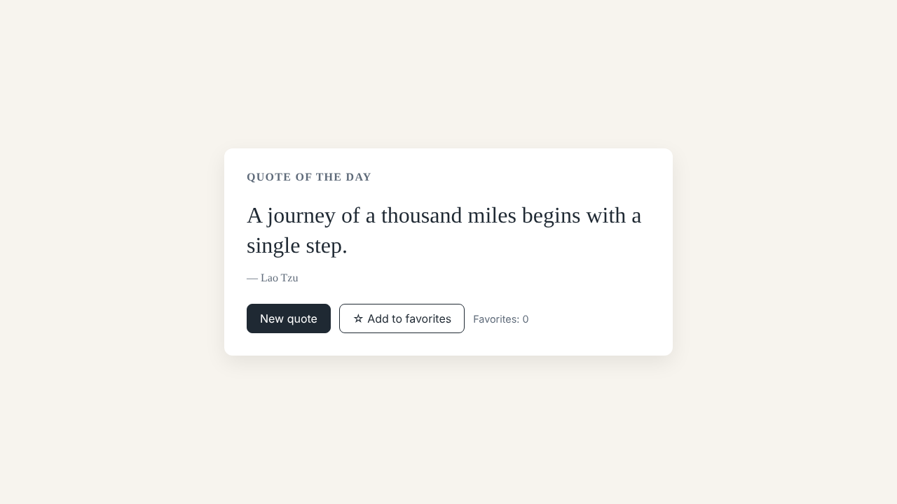

# Week 2 Writeup: Spec-Driven Development with Spec Kit

- **Spec Kit**: `specify-cli` v1.2.1, initialized with
  `specify init spec-kit-week2 --integration claude --script py`
- **Coding agent**: Claude (Spec Kit's `claude` integration installs the `/speckit-*` skills
  into `.claude/skills/`)
- **Feature**: the pre-scoped quote-of-the-day page
- **Result**: `index.html` + `src/` + `tests/`; `node --test` shows **11/11 passing**;
  final `/speckit-converge` reports **Converged**

Every stage was committed separately, so `git log` shows the loop in order:

```text
bf196fe Initialize Spec Kit project with Claude integration (specify-cli v1.2.1)
29bb05d docs: ratify constitution v1.0.0 (code quality, testing, maintainability)
54c087a spec: add 001-quote-of-the-day specification and quality checklist
5a2f8b3 plan: add implementation plan, research, data model, contracts, quickstart
4ac334f tasks: generate dependency-ordered tasks for 001-quote-of-the-day
24a333e plan: fix test command (node --test tests/ fails on Node 22)        <- refinement 1
41f7c3d implement: quote of the day page, logic module, and unit tests (T001-T014)
f4ddf99 implement: mark T001-T016 complete after tests and browser validation (V1-V7 pass)
992976d spec: refine FR-003 so New quote never repeats the current quote    <- refinement 2
6cbb9a0 converge: append Phase 7 tasks T017-T018 for refined FR-003
950696e implement: New quote excludes the current quote (T017-T018); 11/11 tests pass
```

## 1. Prompts given to each skill

| Skill | Prompt | Artifact produced |
|---|---|---|
| `/speckit-constitution` | `Create principles focused on code quality, testing, and maintainability.` | [`.specify/memory/constitution.md`](.specify/memory/constitution.md) v1.0.0: 5 principles (readable code; testable logic, thin UI; tests pass before "done"; simplicity; graceful failure and accessibility), quality gates, workflow, governance |
| `/speckit-specify` | `A quote-of-the-day page: one random quote from a built-in list, a "New quote" button, and favoriting that persists across reloads.` | [`spec.md`](specs/001-quote-of-the-day/spec.md): 3 prioritized user stories, 8 FRs, 4 success criteria, edge cases; [`checklists/requirements.md`](specs/001-quote-of-the-day/checklists/requirements.md) all passing |
| `/speckit-plan` | `Use plain HTML/CSS/JavaScript, no backend; persist favorites in localStorage.` | [`plan.md`](specs/001-quote-of-the-day/plan.md), [`research.md`](specs/001-quote-of-the-day/research.md), [`data-model.md`](specs/001-quote-of-the-day/data-model.md), [`contracts/`](specs/001-quote-of-the-day/contracts/), [`quickstart.md`](specs/001-quote-of-the-day/quickstart.md) |
| `/speckit-tasks` | *(no arguments)* | [`tasks.md`](specs/001-quote-of-the-day/tasks.md): T001–T016 in 6 phases, grouped by user story |
| `/speckit-implement` | *(no arguments)* | `index.html`, `src/quotes.js`, `src/app.js`, `src/styles.css`, `tests/quotes.test.js`, `README.md` |
| `/speckit-converge` | *(no arguments)*, run 3 times | Pass 1: Converged. Pass 2 (after the spec refinement): appended Phase 7 (T017–T018). Pass 3: Converged |

**Review gate between stages.** I read each artifact before running the next skill. The
review of `plan.md` led to one key decision: use classic `<script>` tags instead of ES
modules, because browsers block module scripts from `file://`. The page has to work by
double-clicking `index.html` ([research R1](specs/001-quote-of-the-day/research.md)).

## 2. Before/after: refining the spec changed the output

**What went wrong.** The first spec said FR-003: *"replaces the displayed quote with a
randomly selected quote from the collection."* That was a faithful reading of the prompt.
The implementation matched it, every quickstart check passed, and the first converge run
said **Converged**. But when the page was tested in a browser (60 presses of "New
quote"), **4 of 60 presses picked the quote already on screen**. With 12 quotes, about 1 in
12 presses looked like the button did nothing.

The code wasn't wrong: it did exactly what the spec said. The **spec** was vague, so the
constitution's workflow rule applies: fix the spec, not the code.

**The refinement** (commit `992976d`, excerpt of the diff):

```diff
 - **FR-003**: The page MUST provide a "New quote" button that, when activated, replaces the
-  displayed quote with a randomly selected quote from the collection.
+  displayed quote with a randomly selected quote from the collection **other than the one
+  currently displayed** (if the collection has only one quote, that quote stays).
```

The same commit updates US2 acceptance scenario 1, an edge case, the assumption about
randomness, and the logic contract: `pickRandomQuote` gains an `excludeId` parameter. It
also adds [research R7](specs/001-quote-of-the-day/research.md), which explains why the
current quote is excluded before picking rather than re-rolling until the quote changes.

**How the output changed:**

| | Before refinement | After refinement |
|---|---|---|
| `/speckit-converge` | ✅ Converged (spec was satisfied) | Found `F1 partial HIGH FR-003` and appended T017–T018 |
| `pickRandomQuote` | `(quotes, random)` | `(quotes, random, excludeId)`; filters out the current quote first |
| `onNewQuote` in `app.js` | `pickRandomQuote(QUOTES)` | `pickRandomQuote(QUOTES, Math.random, state.current.id)` |
| Tests | 9 | 11 (regression test written first and seen failing, per Constitution III) |
| Browser: presses that repeated the quote | **4 / 60** | **0 / 60** |

**A smaller refinement to the plan** (commit `24a333e`): the plan's test command,
`node --test tests/`, fails on Node 22 with `Cannot find module '.../tests'`, because a
directory is no longer accepted as a test path. I fixed `plan.md`, `quickstart.md`, and
`tasks.md` to use `node --test`, and recorded the reason in research R6. I did this before
committing any code, so the artifacts and the code agree.

## 3. Convergence outcome

| Run | When | Result |
|---|---|---|
| Converge 1 | After implementing T001–T016 | ✅ Converged: 8/8 FRs, 4/4 SCs, 9/9 acceptance scenarios, constitution I–V; `tasks.md` unchanged |
| Converge 2 | After refining FR-003 | 1 finding (`F1`, partial, HIGH, FR-003 / US2-AC1) → appended `## Phase 7: Convergence` with T017 (regression tests) and T018 (fix) |
| Converge 3 | After implementing T017–T018 | ✅ **Converged**: 18/18 tasks complete, 11/11 tests passing; `tasks.md` unchanged |

**Verification (final run):** `node --test` gives 11 passed, 0 failed. Every manual check
V1–V7 from [`quickstart.md`](specs/001-quote-of-the-day/quickstart.md) passed in Chromium,
plus a blocked-`localStorage` check for FR-008 and zero console errors:

```text
PASS V1 quote="A journey of a thousand miles begins with a single step."
PASS V2 7 distinct quotes in 10 reloads
PASS V3 New quote works by click/Enter/Space; 0/60 presses showed the SAME quote again
PASS V4 aria-pressed=true label="Remove from favorites"
PASS V5 favorite kept after reload
PASS V6 unfavorite persisted
PASS V7 corrupted storage handled
PASS FR-008 blocked storage: favoriting works, notice shown
PASS console no errors
```



## 4. What I learned

SDD felt like overhead at the start. Writing a constitution, three user stories, a data
model, and two contracts for a 60-line page took longer than writing the page would have.
It paid off at the two points where something was wrong. The clearest example: converge
reported "Converged" while the button visibly misbehaved. That showed me the agent can only
be as precise as the spec, and the fix was a one-sentence change to FR-003 that then flowed
mechanically into a new task, a regression test, and code. Keeping the spec as the source
of truth also meant every change has a written reason, such as research R6 and R7, instead
of a mystery diff. Next time I would spend more review time on the acceptance scenarios,
because that's where the vagueness was hiding.
